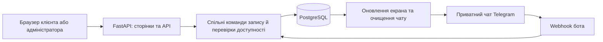

# Архітектура та карта коду

## Як усе працює разом

Сайт і бот — один Python-застосунок, один репозиторій та одна база. Telegram
отримує події через HTTPS webhook; окремий polling-процес не потрібен. Усередині
FastAPI lifespan працює фонове оновлення поточного екрана бота. Тести й локальний
перегляд використовують інші бази.

## Де змінювати поведінку

| Частина | Джерело |
| --- | --- |
| HTTP-маршрути, Google OAuth, кабінет, побудова календаря й зошита | `app/main.py` |
| Моделі SQLModel, запити/відповіді, статуси | `app/models.py` |
| Часові інтервали, успадкування графіків, перетини, транзакційний lock | `app/booking.py` |
| Команди запису для сайту й бота, редагування контакту у вебзошиті | `app/diary_commands.py` |
| Пакетне збереження чернетки адмінки, версії, попередження про зміну графіка | `app/admin_changes.py` |
| Виявлення записів поза зміненим графіком | `app/schedule_review.py` |
| Категорії, публічна видимість і порядок каталогу | `app/catalog.py` |
| Перевірка та зберігання фото | `app/product_photos.py` |
| Cookies, CSRF, Google-права адміністратора, ліміти, HTTP-заголовки | `app/security.py` |
| Налаштування й перевірка production-конфігурації | `app/config.py` |
| Прив'язка/від'єднання Telegram, одноразовий запит | `app/telegram_link.py` |
| Команди бота, callbacks, webhook, транзакційний outbox | `app/telegram_bot.py` |
| Доставка Telegram API та санітизовані помилки | `app/telegram_transport.py` |
| Автооновлення, окремий lock інтерфейсу чату | `app/telegram_refresh.py` |
| Облік ID відомих повідомлень і безпечне очищення | `app/telegram_chat.py` |
| Явне налаштування webhook та команд бота | `app/telegram_setup.py` |
| Події журналу дій | `app/admin_audit.py` |
| З'єднання й залежність Session | `app/database.py` |

Перед правкою звірити назви з деревом файлів: карта має оновлюватися разом із кодом.

## Інтерфейс

- Jinja2: `app/templates/`. `brand.html` — спільний бренд; `public_header.html`
  та `admin_base.html` — шапки. `site_name` задається як глобальна змінна шаблонів.
- Головна сторінка: `index.html`, `landing_base.html`, `static/js/landing.js`.
- Запис: `booking.html`, `static/js/booking.js`.
- Адмінка: `admin*.html`, `static/js/admin.js`. Чернетка зберігається в
  `sessionStorage`; це не серверна база і не резервна копія.
- Кабінет: `cabinet.html`, `static/js/telegram-link.js`. Без JavaScript є
  проміжна сторінка `telegram_link.html` із посиланням на бота.
- Стилі: `app/static/css/`; версії ресурсів — константи в `main.py`.

## Дані та транзакції

Постійні дані живуть у PostgreSQL, включно з JPEG-фото товарів, прив'язками
адміністраторів, блокуваннями годин, журналом дій та станом бота. Git містить
код і міграції, а не актуальний каталог чи пацієнтів. Початкові значення в
`main.py` — seed для порожньої бази, а не копія production-налаштувань.

Перевірка перетину й запис виконуються під одним lock: PostgreSQL advisory
transaction lock, SQLite `BEGIN IMMEDIATE`. Унікальний індекс однакового старту
не замінює перевірку всього інтервалу. Скасований запис час не займає.

Сайт і бот передають версію запису; застаріла дія повертає конфлікт. Контролери
керують commit/rollback. Outbox зберігається разом із зміною даних, а мережеві
запити Telegram виконуються після цього. Окремий lock чату впорядковує ручні й
фонові зміни екрана; він не замінює lock бронювання.

## Перевірки

`tests/test_app.py`, `test_admin_changes.py`, `test_security.py`,
`test_migrations.py`, `test_telegram.py` перевіряють поведінку та конкурентні
зміни. `tests/browser/flows.cjs` — браузерні сценарії з ізольованим preview.
Команди й обмеження середовища: [DEVELOPMENT.md](DEVELOPMENT.md).
